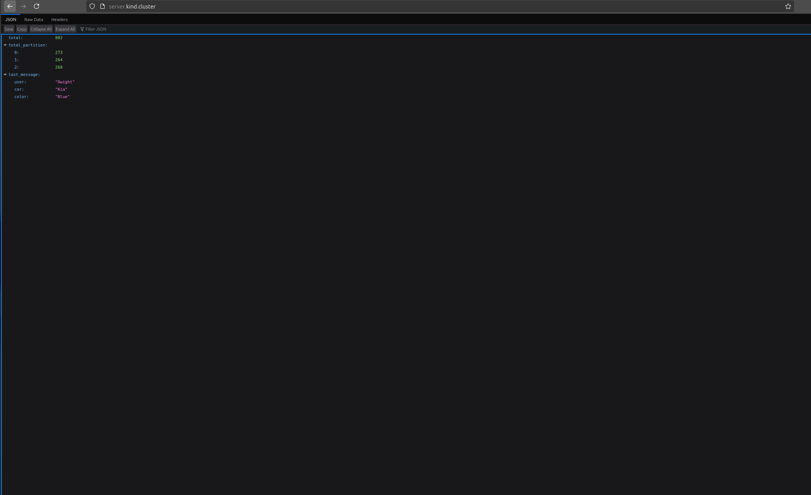
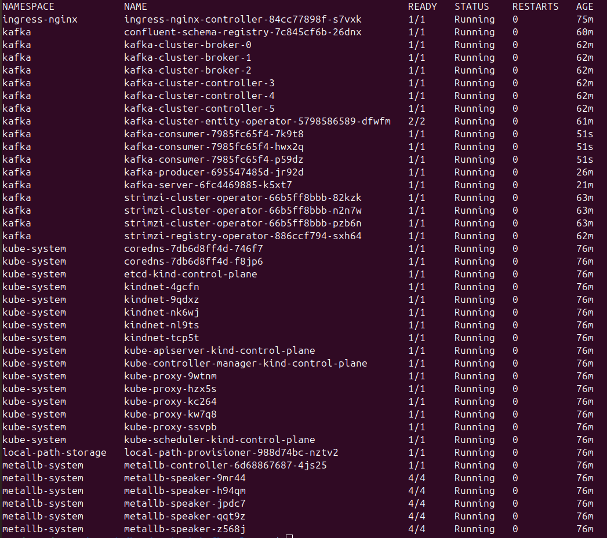

# Use Strimzi to setup Kafka cluster with Schema Registry in Kubernetes

Producer, Consumer and Schema Registry use mTLS to authentificate and authorize in Kafka Cluser.

Alternative authentication methods are also supported: SASL_SSL (SCRAM-SHA-512 over TLS), SASL_PLAINTEXT (SCRAM-SHA-512 over plaintext) and PLAINTEXT (no authentication).

## Requirements

- docker
- kubectl
- kind cli
- helm
- curl and jq (only for `./schema-install.sh`)

## Setup kubernetes cluster

Run `./cluster-setup.sh` and you got 1 control-plane nodes and 3 worker nodes kubernetes cluster with installed ingress-nginx, metallb and 4 proxy image repository in docker containers in one network

## Deploy Kafka and Schema Registry

Run `./kafka-cluster.sh` to deploy 3 Kafka brocker and 3 Kafka KRaft control node and Schema Registry. Schema-registry required special user and topic to storage his data in Kafka so we deploy them too.

Schema-Registry deployed using [ssr-operator.](https://github.com/Randsw/schema-registry-operator-strimzi)

The ssr-operator Helm chart is pinned to a version that ships the current `StrimziSchemaRegistry` CRD. The CRD evolved a lot: the current `spec` includes `clientauth`, `configuration`, `kafkastoretopic`, `kafkastoretopicreplicationfactor`, `schemaregistrygroupid`, `mastereligibility`, `service` (with `type`, `port`, `nodeport`, `annotations` and `labels`) and `networkpolicy` (with `enabled` and `allowcrossnamespaceingress`). Make sure you install a chart version that carries these fields (chart `0.0.25` or newer) before you apply a CR that uses them.

User deployed usind `KafkaUser` CR and named `confluent-schema-registry`. The name **must match the `StrimziSchemaRegistry` CR name**, because the operator looks up the KafkaUser secret by the CR name.

Topic deployed usind `KafkaTopic` CR and named `registry-schemas`. This is also the default value of `spec.kafkastoretopic`.

### Authentication methods

By default `./kafka-cluster.sh` deploys the cluster with TLS (mTLS client certificate) authentication. Three alternative deployment scripts are available:

| Script | Kafka listener | `securityprotocol` | `KafkaUser` authentication | Description |
| --- | --- | --- | --- | --- |
| `./kafka-cluster.sh` | `tls` (port 9093, TLS) | `SSL` | `tls` | mTLS client certificate authentication. The operator builds a keystore and truststore from the KafkaUser secret. |
| `./kafka-cluster-sasl-ssl.sh` | `saslssl` (port 9093, TLS) | `SASL_SSL` | `scram-sha-512` | SCRAM-SHA-512 authentication over TLS. The operator builds only a truststore and reads the SCRAM credentials directly from the KafkaUser secret. |
| `./kafka-cluster-sasl-plain.sh` | `saslplain` (port 9092, plaintext) | `SASL_PLAINTEXT` | `scram-sha-512` | SCRAM-SHA-512 authentication over plaintext transport. No certificates or keystore are required. |
| `./kafka-cluster-plain.sh` | `plain` (port 9092, plaintext) | `PLAINTEXT` | none | No authentication and no TLS. No `KafkaUser` is deployed; unauthenticated clients are mapped to the `ANONYMOUS` principal. |

Run the script for the authentication method you need, e.g. `./kafka-cluster-sasl-ssl.sh` for SASL_SSL or `./kafka-cluster-plain.sh` for PLAINTEXT. Each script deploys the full stack: Strimzi operator, Kafka cluster with the corresponding listener, `registry-schemas` topic, `confluent-schema-registry` KafkaUser (except for PLAINTEXT), ssr-operator and the Schema Registry with an ingress.

The `KafkaUser` name is intentionally **not** listed in `authorization.superUsers` for the SASL scenarios, so the ACLs defined on the `KafkaUser` are what actually grant the Schema Registry access to the `registry-schemas` topic and the `schema-registry` consumer group. For PLAINTEXT, `ANONYMOUS` must be a super user since the listener cannot identify the client.

:warning: Only one of these scripts should be run against the same cluster, since they deploy resources with identical names.

### StrimziSchemaRegistry configuration

The Schema Registry is deployed with a `StrimziSchemaRegistry` CR. Its `spec` supports the following fields:

| Field | Description | Default |
| --- | --- | --- |
| `securehttp` | Enable TLS on the Schema Registry REST API endpoint (required). When `true` the managed Service exposes port `443` to container port `8085` and the API is served over HTTPS; when `false` it exposes port `80` to `8081` over HTTP. | — |
| `clientauth` | Enable mutual TLS on the REST API: clients must present a certificate signed by the Kafka cluster CA. Only valid together with `securehttp: true`; otherwise the CR becomes `Ready=False` with reason `ClientAuthRequiresSecureHTTP`. | `false` |
| `listener` | Name of the Kafka listener the Schema Registry connects to. | `tls` |
| `compatibilitylevel` | Default schema compatibility level: `none`, `backward`, `backward_transitive`, `forward`, `forward_transitive`, `full`, `full_transitive`. | `forward` |
| `securityprotocol` | Kafka security protocol: `SSL`, `SASL_SSL`, `PLAINTEXT`, `SASL_PLAINTEXT`. The authentication method is auto-detected from the referenced `KafkaUser`. | `SSL` |
| `heapopts` | JVM heap options for the Schema Registry, e.g. `-Xms512M -Xmx512M`. | `-Xms512M -Xmx512M` |
| `tlssecretname` | Name of the secret with the JKS keystore used by the REST API. Leave empty to let the operator generate one signed by the Kafka cluster CA. When set it must be a DNS label (lowercase, no dots). | `""` |
| `kafkastoretopic` | Kafka topic used to store schemas. | `registry-schemas` |
| `kafkastoretopicreplicationfactor` | Replication factor for the auto-created storage topic. Must be `>= 1`. Leave unset to keep Confluent's built-in default (`3`). | unset |
| `schemaregistrygroupid` | Kafka consumer group id used by the Schema Registry. | `schema-registry` |
| `mastereligibility` | Whether this instance may be elected master. | `true` |
| `configuration` | Arbitrary Confluent Schema Registry properties (dotted keys) rendered as `SCHEMA_REGISTRY_*` environment variables. Operator-managed keys are ignored with a `ConfigKeyOverridden` warning event. | unset |
| `service.type` | Kubernetes Service type: `ClusterIP`, `NodePort` or `LoadBalancer`. | `ClusterIP` |
| `service.port` | Overrides the Service port. Defaults to `80` for plain HTTP and `443` for TLS REST endpoints. | unset |
| `service.nodeport` | Pins the node port when `service.type` is `NodePort` or `LoadBalancer`. When unset, Kubernetes allocates one automatically. | unset |
| `service.annotations` / `service.labels` | Passed through to the managed Service, e.g. Prometheus scrape annotations. | unset |
| `networkpolicy.enabled` | Create a NetworkPolicy allowing ingress on the REST API port and egress to the Kafka bootstrap service (plus DNS via kube-dns). | `false` |
| `networkpolicy.allowcrossnamespaceingress` | When `true` (and `networkpolicy.enabled` is `true`), allows ingress to the Schema Registry from all namespaces instead of only the namespace of the `StrimziSchemaRegistry` resource, so the registry stays reachable through an ingress controller running in a different namespace. | `false` |
| `template` | Kubernetes pod template for the Schema Registry pod (required). | — |

:information_source: Only a single replica is supported. With `securehttp: true`, the generated REST certificate SANs are DNS-only while the Schema Registry `host.name` is the pod IP, so HTTPS forwarding between replicas would break.

See the [operator documentation](https://github.com/Randsw/schema-registry-operator-strimzi) for the full reference.

Now we have running Kafka Cluser with Schema Registry inside our `kafka` namespace.

You can access Schema registry at `https://schema.kind.cluster` :warning: The Schema Registry is served over HTTPS (HTTP/2 is used by the REST API).

The certificate on that endpoint is generated by ssr-operator and signed by the Kafka cluster CA. Its SANs only cover the in-cluster service name (`confluent-schema-registry`, `confluent-schema-registry.kafka`, `confluent-schema-registry.kafka.svc`, …), so hostname verification fails for `schema.kind.cluster`. Use the cluster CA and the service name when talking to the registry from a client, or `curl --insecure` from your workstation.

To load schema in schema registry see example in `schema-install.sh`. The script extracts the cluster CA certificate, port-forwards the service and registers the schema over HTTPS with proper hostname verification.

## Deploy example producer

First we must create example topic and user for connection to Kafka

Run `kubectl apply -f ./producer/manifests/kafka-user.yaml` to create user named `producer-user`

Run `kubectl apply -f ./producer/manifests/kafka-topic.yaml` to create topic named `example-topic` with 3 partition

Now we ready to deploy our producer:

Run `kubectl apply -f ./producer/manifests/deployment.yaml` to create producer.

Producer code can be find in `./producer` folder

It generates message with 1 second delay and random key from a list `Key-1, Key-2, Key-3`.

As a value we use struct which is filled also randomly:

```go

type message struct {
    User  string `json:"user"`
    Car   string `json:"car"`
    Color string `json:"color"`
}

```

Balance algoritm is `Hash` so message with equal key go to same partition.

## Deploy statistic server

Run `kubectl apply -f ./http_server/manifests/deployment.yaml` to deploy topic statistic server

Run `kubectl apply -f ./http_server/manifests/service.yaml` to deploy service

Run `kubectl apply -f ./http_server/manifests/ingress.yaml` to deploy ingress

Now statistic server opens at `server.kind.cluster`

## Deploy consumer

In this example we create 3 consumer in one consumer group named `example-group`

So each consumer will be consume one patrition.

Each consumer send information at statistic server so we can see how many message we receive total and by patrition.

Also we can see last message.

To deploy consumer group:

Run `kubectl apply -f ./consumer/manifests/kafka-user.yaml` to deploy consumer user named `consumer-user`.

Run `kubectl apply -f ./consumer/manifests/deployment.yaml` to deploy consumer group with 3 instances.

## Result

Example view of statistic server:



Kubernetes pod:


